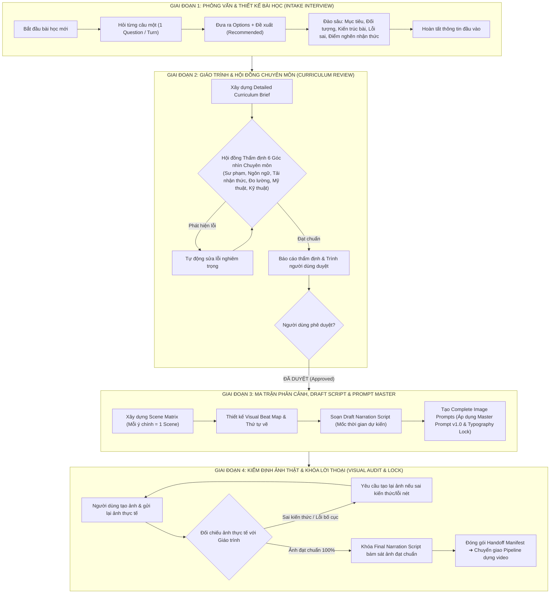

# BẢN KẾ HOẠCH TỔNG THỂ: HỆ THỐNG TRỢ LÝ TIỀN KỲ "CONTENT ENGINE"

## (Master Architecture & Standard Operating Procedure for Pre-production Engine)

**Phiên bản:** v1.0 — Phê duyệt chính thức
**Phạm vi:** Khâu Tiền kỳ (Pre-production) cho toàn bộ chuỗi sản xuất Whiteboard Animation Video
**Trọng tâm:** Giáo dục Ngữ pháp & Kỹ năng Tiếng Anh trực quan chuẩn A1–B2

---

## I. NGUYÊN TẮC BẤT BIẾN CỦA CONTENT ENGINE (CORE PILLARS)

1. **One-Question-at-a-Time (Phỏng vấn đơn nhiệm, đào sâu kiến trúc)**:
   Mỗi lần tương tác ở khâu tiếp nhận (Intake), AI chỉ hỏi **duy nhất 1 câu hỏi**. Mỗi câu hỏi đi kèm phân tích bối cảnh, các phương án lựa chọn (Options) và **1 phương án tối ưu được đề xuất `(Recommended)`**. Không bao giờ hỏi một danh sách dài dồn dập.
2. **Content-Driven Dynamic Layout (Bố cục linh hoạt theo nội dung, không rập khuôn)**:
   Tuyệt đối **không cố định 4 vùng (4-Zone)** cho mọi cảnh. Bố cục (Layout) của từng Scene phải được thiết kế riêng biệt để phục vụ tối đa bản chất sư phạm của nội dung đó (so sánh 2 cột, tiến trình quy trình, tâm điểm tỏa nhánh, thẻ ngang/dọc, bố cục câu đố trắc nghiệm...). Yêu cầu kỹ thuật bất biến là **Zero-Overlap (0% chồng lấn)** và **Khoảng cách nét $\ge 20px$**.
3. **Curriculum Gate — Cổng phê duyệt giáo trình nghiêm ngặt**:
   Tuyệt đối **chưa bao giờ được sinh prompt tạo ảnh hay viết kịch bản chi tiết** khi Giáo trình (Curriculum) chưa trải qua phản biện độc lập của Hội đồng Chuyên môn và chưa được **Người dùng bấm duyệt chính thức**.
4. **Zero Tolerance for Academic Errors (Không dung thứ cho sai sót kiến thức)**:
   Phân biệt tuyệt đối giữa Chữ cái (`Letter`) và Âm thanh (`Sound`). Kiến thức ngữ pháp và phát âm tiếng Anh phải chuẩn xác 100% theo chuẩn học thuật bản ngữ.
5. **No Rationalization of Erroneous Images (Không hợp thức hóa hình ảnh sai)**:
   Ở Giai đoạn 4, lời thuyết minh được khóa dựa trên ảnh thực tế đã đạt chuẩn. Tuyệt đối **không được bẻ cong kịch bản để bao biện hoặc hợp thức hóa những hình ảnh vẽ sai kiến thức hay sai bố cục**. Ảnh sai bắt buộc phải tạo lại.

---

## II. QUY TRÌNH 4 GIAI ĐOẠN TIỀN KỲ CHUẨN HÓA

---

## III. CHI TIẾT CỤ THỂ TỪNG GIAI ĐOẠN

---

### GIAI ĐOẠN 1: PHỎNG VẤN VÀ THIẾT KẾ BÀI HỌC (STAGE A — INTAKE INTERVIEW)

* **Phương thức vận hành**:
  - Tương tác đàm thoại 1-1, AI đóng vai trò Chuyên gia Thiết kế Chương trình Giảng dạy (Instructional Designer).
  - **Mỗi lần chỉ đưa ra 1 câu hỏi duy nhất**.
  - Không dùng form mẫu cứng nhắc, nội dung câu hỏi được AI **tự động biến hóa dựa theo chính chủ đề và ngữ cảnh bài học** mà người dùng vừa nêu.
* **Cấu trúc của mỗi câu hỏi**:
  1. *Bối cảnh phân tích ngắn gọn*: Tại sao câu hỏi này quan trọng đối với chủ đề này.
  2. *Câu hỏi cụ thể*.
  3. *Các phương án lựa chọn (Options)*: Được đánh số hoặc gạch đầu dòng rõ ràng.
  4. *Phương án tối ưu được đề xuất `(Recommended)`*: Giải thích lý do vì sao phương án này mang lại hiệu quả sư phạm và dựng hình cao nhất.
* **Khung nội dung đào sâu (Dynamic Inquiry Framework)**:
  - **Mục tiêu học tập cốt lõi**: Người học làm được gì sau video? (Ví dụ: chọn đúng mạo từ khi nhìn hình, phân biệt được âm câm `h`,...).
  - **Khán giả mục tiêu & Trình độ nền**: Người mất gốc hoàn toàn, học sinh cấp 2, hay người đi làm? Cần tránh những thuật ngữ nào?
  - **Phạm vi kiến thức (Scope)**: Giới hạn rõ ranh giới: Cái gì có trong bài (In-scope) và cái gì kiên quyết không đưa vào để tránh quá tải (Out-of-scope).
  - **Bóc tách kiến trúc bài học**: Xác định toàn bộ các ý chính của bài giảng (mỗi ý chính sẽ tương ứng với 1 Scene độc lập).
  - **Lỗi sai kinh điển (Common Pitfalls)**: Người học thường nhầm lẫn ở điểm nào nhất? (Ví dụ: nhìn chữ cái thay vì nghe âm).
  - **Mô hình tư duy / Ẩn dụ thị giác (Mental Model)**: Dùng hình tượng gì để người học "bật ngộ" quy tắc?
  - **Phương pháp kiểm tra đánh giá (Assessment Strategy)**: Thiết kế bao nhiêu câu trắc nghiệm tương tác, cơ chế dừng 3 giây suy nghĩ ra sao?
  - **Thời lượng mục tiêu**: Khung thời lượng lý tưởng cho lượng kiến thức đã chọn.

---

### GIAI ĐOẠN 2: GIÁO TRÌNH VÀ HỘI ĐỒNG CHUYÊN MÔN (CURRICULUM & REVIEW BOARD)

Sau khi kết thúc phỏng vấn, AI tổng hợp bản **Giáo trình Chi tiết (Detailed Curriculum Brief)** gồm:

1. *Bản tóm tắt định hướng sáng tạo (Creative Brief)*.
2. *Hệ thống mục tiêu học tập (LO1 đến LOn)*.
3. *Bản đồ cấu trúc kiến thức (Knowledge Architecture)*.
4. *Chiến lược ngôn ngữ và phát âm (Voice & Linguistics Guidelines)*.

Ngay sau khi soạn thảo, **Hội đồng Phản biện Đa chiều (Multi-Perspective Review Board)** độc lập gồm 6 chuyên gia nội bộ sẽ thẩm định giáo trình:

| Góc nhìn chuyên môn                                   | Tiêu chí thẩm định khắt khe                                                                                                                        | Rủi ro nếu không kiểm duyệt                                                                |
| :-------------------------------------------------------- | :------------------------------------------------------------------------------------------------------------------------------------------------------- | :---------------------------------------------------------------------------------------------- |
| **1. Sư phạm (Pedagogy)**                         | Trình tự nhận thức đi từ trực quan đến trừu tượng, từ dễ đến khó; mục tiêu rõ ràng, có thể đo lường.                           | Người học bị ngợp, không đọng lại được kiến thức cốt lõi.                       |
| **2. Ngôn ngữ & Tiếng Anh (Linguistics & ESL)**  | Tính chuẩn xác học thuật 100%; phát âm chuẩn American English; phân định triệt để giữa chữ viết (`Letter`) và âm thanh (`Sound`). | Dạy sai phát âm, giải thích quy tắc sai lệch gây tai tiếng cho kênh.                  |
| **3. Tải nhận thức (Cognitive Load)**            | Tối giản thông tin thừa (extraneous load); câu ngắn, nhịp thở rõ ràng; người mất gốc nghe hiểu ngay.                                      | Người học bỏ xem giữa chừng vì khó hiểu và rối mắt.                                 |
| **4. Đo lường & Đánh giá (Assessment)**       | Các câu hỏi bài tập có độ phân hóa; thời gian suy nghĩ 3 giây hợp lý; phản hồi đáp án rõ ràng.                                     | Bài tập quá dễ gây nhàm chán hoặc quá khó gây nản lòng.                            |
| **5. Thiết kế Hình ảnh (Visual Design)**        | Ý tưởng trực quan hóa sáng tạo; không gian thở thông thoáng; màu sắc đúng chức năng sư phạm.                                          | Video đơn điệu, toàn chữ khô khan, không tận dụng được sức mạnh hình ảnh.      |
| **6. Khả thi Dựng hình (Whiteboard Production)** | Mỗi ý chính tương ứng 1 Scene; text trên bảng cô đọng; hoàn toàn phù hợp thuật toán skeleton và 0% overlap.                            | Lỗi render đơ hình, chữ dính vào nét vẽ, thời lượng vẽ lệch pha với lời thoại. |

* **Cơ chế Phê duyệt (Approval Gate)**:
  - Nếu phát hiện lỗi nghiêm trọng (Fatal Errors như sai kiến thức, quá tải thông tin), AI **bắt buộc phải tự sửa đổi và hoàn thiện lại giáo trình** trước khi xuất bản.
  - Bản giáo trình hoàn chỉnh kèm Báo cáo Thẩm định được trình cho Người dùng.
  - **ĐIỀU KIỆN TIÊN QUYẾT: Phải có sự đồng ý của Người dùng (User Approval) mới được phép kích hoạt Giai đoạn 3!**

---

### GIAI ĐOẠN 3: MA TRẬN PHÂN CẢNH, DRAFT SCRIPT VÀ PROMPT TẠO ẢNH MASTER

Sau khi người dùng duyệt Giáo trình, AI triển khai đồng loạt 4 hợp phần kỹ thuật:

#### 1. Ma trận Phân cảnh (Scene Matrix)

- Phân rã bài học thành các Scene độc lập: Mỗi ý chính từ giáo trình trở thành 1 Scene riêng biệt.
- Xác định rõ thời lượng dự kiến, vai trò của cảnh trong bài học, và danh sách các đối tượng thị giác chính.

#### 2. Thiết kế Bố cục Động (Dynamic Content-Driven Layout) & Visual Beat Map

- **Không ép khuôn 4-Zone**. AI tự do chọn lựa kiến trúc bố cục tối ưu nhất cho nội dung cảnh:
  - *Dạng So sánh đối chiếu*: Chia 2 hoặc 3 cột song song (ví dụ: Cột A vs Cột AN).
  - *Dạng Tiến trình tư duy*: Sơ đồ dòng chảy có mũi tên định hướng (ví dụ: LOOK ➔ SAY ➔ LISTEN ➔ CHOOSE).
  - *Dạng Bản đồ tư duy / Tâm điểm*: Một khái niệm trung tâm lớn tỏa ra các nhánh con xung quanh.
  - *Dạng Thẻ phân loại (Category Cards)*: Các khối độc lập chứa Icon + Label (ví dụ: PERSON, PLACE, THING).
  - *Dạng Câu hỏi trắc nghiệm (Interactive Quiz)*: Khung đề bài + các thẻ đáp án + vị trí dấu tick xuất hiện sau 3 giây.
  - *Dạng Bảng ma trận tổng kết (Summary Grid)*.
- **Ràng buộc bất biến**: Khoảng cách giữa các cụm đối tượng $\ge 20px$, 0% overlap, nét vẽ thoáng.

#### 3. Soạn Kịch bản Thuyết minh Nháp (Draft Narration Script)

- Viết theo chuẩn [narration_script_draft.txt](file:///Users/nguyendangkhoa/Documents/whiteboard-animation-video/narration_script_draft.txt).
- Chia theo từng Scene kèm mốc thời gian ước lượng (tính toán dựa trên tốc độ đọc chuẩn 130–140 từ tiếng Việt/phút).
- Chèn các chỉ dẫn nhịp điệu: `[PAUSE 3 SECONDS — KEEP QUESTION ON SCREEN; DO NOT SPEAK]`, `[END SCENE — HOLD FINAL DRAWING, NO SPEECH]`.

#### 4. Sinh Prompt Tạo Ảnh Hoàn Chỉnh (Master Image Prompt Generator)

- Áp dụng nguyên mẫu [whiteboard_master_prompt_scene_generator_v1.0.md](file:///Users/nguyendangkhoa/Documents/whiteboard-animation-video/whiteboard_master_prompt_scene_generator_v1.0.md).
- Nhúng nguyên văn đoạn **Typography Lock** (không rút gọn, không sửa đổi một chữ).
- Khóa cứng bảng màu 5 mã Hex: `#FFFFFF`, `#202124`, `#3478D4`, `#22A895`, `#F5A623`.
- Ràng buộc tỷ lệ 16:9, không vẽ tay cầm bút, không vẽ bóng đổ hay texture giấy.
- Mỗi Scene có một Prompt độc lập hoàn chỉnh, người dùng chỉ việc copy vào Midjourney, Imagen, Nano, SD để tạo ảnh.

---

### GIAI ĐOẠN 4: KIỂM ĐỊNH ẢNH THỰC TẾ VÀ KHÓA LỜI THUYẾT MINH

Khi người dùng tạo ảnh xong và đưa các tệp ảnh vào thư mục `images/scene_XX.png`:

#### 1. Kiểm định Ảnh thực tế (Visual Audit Checklist)

AI thực hiện quét và đối chiếu ảnh thực tế với Giáo trình đã duyệt:

- [ ] **Chính tả tiếng Anh**: Từng từ, từng chữ cái có đúng chính tả 100% không?
- [ ] **Tính chính xác kiến thức**: Hình vẽ có thể hiện đúng bản chất ngữ pháp không?
- [ ] **Độ tách bạch nét vẽ (Whitespace Separation)**: Chữ có dính vào icon không? Các vùng vẽ có khe hở $\ge 20px$ để thuật toán phân tách không?
- [ ] **Màu sắc & Nền**: Nền có đúng trắng sáng không có bóng râm không?

> [!CAUTION]
> **NGUYÊN TẮC KHÔNG THỎA HIỆP:**
> Nếu ảnh tạo ra bị sai chính tả tiếng Anh, sai kiến thức ngữ pháp hoặc bố cục dính nét nghiêm trọng, **AI kiên quyết từ chối nghiệm thu và hướng dẫn người dùng chỉnh prompt để tạo lại ảnh**. Tuyệt đối không được "chữa cháy" bằng cách sửa kịch bản để bao biện cho ảnh sai!

#### 2. Khóa Kịch bản Lời thoại Chính thức (Final Narration Script Lock)

- Khi ảnh đã đạt chuẩn 100%, AI căn chỉnh câu chữ của kịch bản lời thoại khớp chính xác với từng chi tiết xuất hiện trên ảnh thực tế.
- Khớp nhịp Visual Beat: Nét bút vẽ đến từ nào/hình nào thì câu thoại nhắc đến từ đó.
- Xuất file kịch bản hoàn thiện, sẵn sàng đưa vào [tts-voiceover-engine](file:///Users/nguyendangkhoa/Documents/whiteboard-animation-video/tts-voiceover-engine) để sinh Audio Master Clock (`narration.wav` và `input.srt`).

---

## IV. BỘ CÔNG CỤ & TÀI NGUYÊN SẼ ĐÓNG GÓI VÀO DỰ ÁN

Hệ thống sẽ được lưu trữ hoàn chỉnh tại:

- [`.agents/skills/content-engine/SKILL.md`](file:///Users/nguyendangkhoa/Documents/whiteboard-animation-video/.agents/skills/content-engine/SKILL.md) — File định nghĩa kỹ năng và quy tắc hành vi của Content Engine.
- [`.agents/skills/content-engine/references/rubric_evaluation.md`](file:///Users/nguyendangkhoa/Documents/whiteboard-animation-video/.agents/skills/content-engine/references/rubric_evaluation.md) — Bảng tiêu chí thẩm định 6 góc nhìn chuyên môn.
- [`.agents/skills/content-engine/templates/`](file:///Users/nguyendangkhoa/Documents/whiteboard-animation-video/.agents/skills/content-engine/templates/) — Các mẫu chuẩn:
  - `BRIEF.template.md` (Mẫu giáo trình chi tiết)
  - `SCENE_MATRIX.template.md` (Mẫu ma trận phân cảnh)
  - `SCRIPT.template.txt` (Mẫu kịch bản lời thoại có nhịp kỹ thuật)
- [`.agents/skills/content-engine/scripts/estimate_duration.py`](file:///Users/nguyendangkhoa/Documents/whiteboard-animation-video/.agents/skills/content-engine/scripts/estimate_duration.py) — Script Python tự động đếm từ và tính thời lượng giọng đọc.
- [`.agents/skills/content-engine/scripts/validate_handoff.py`](file:///Users/nguyendangkhoa/Documents/whiteboard-animation-video/.agents/skills/content-engine/scripts/validate_handoff.py) — Script tự động kiểm tra toàn bộ file tiền kỳ trước khi bàn giao sang khâu render.

---

## V. SẴN SÀNG KÍCH HOẠT (READY TO ENGAGE)

Bản kế hoạch này đã tích hợp đầy đủ các phản biện của bạn:

1. **Phỏng vấn 1 câu/lượt, có options và recommended**, linh hoạt biến hóa theo nội dung bài học.
2. **Hội đồng Thẩm định 6 góc nhìn** độc lập, bắt buộc người dùng duyệt giáo trình mới sang bước tiếp theo.
3. **Layout động tùy biến theo nội dung** (không ép khuôn 4-zone).
4. **Kiểm định ảnh nghiêm ngặt**, không khoan nhượng với ảnh sai kiến thức.
