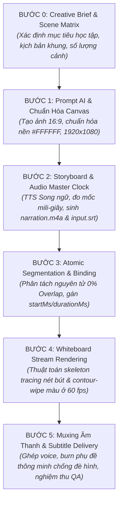

# QUY TRÌNH CHUẨN SẢN XUẤT VIDEO WHITEBOARD ANIMATION
## (End-to-End Master Workflow for Educational Whiteboard Animation)

---

## I. TỔNG QUAN HỆ THỐNG (SYSTEM OVERVIEW)

Tài liệu này định nghĩa quy trình chuẩn hóa (SOP - Standard Operating Procedure) để sản xuất video diễn hoạt bảng trắng (**2D Whiteboard Animation**) chất lượng cao, phục vụ giảng dạy ngữ pháp tiếng Anh và các nội dung giáo dục trực quan.

### 1. Triết lý cốt lõi
1. **Audio Master Clock (Âm thanh là đồng hồ chủ)**: Không bao giờ vẽ trước rồi mới tìm cách co giãn âm thanh để ghép vào. Âm thanh (Voice-over) được thu trước, đo đạc chính xác từng mili-giây (`startMs`, `durationMs`) để làm thước đo tuyệt đối điều khiển toàn bộ timeline hoạt họa.
2. **Atomic Segmentation & Zero Overlap (Phân rã nguyên tử & Không chồng lấn)**: Hình ảnh minh họa phải được phân rã thành các khối nguyên tử độc lập (Atomic Elements). Không bao giờ gộp cả thẻ/cụm lớn thành một hộp chứa bao phủ các phần tử con (nguyên nhân gây lỗi giật/đơ - freeze and pop ở Case 07).
3. **Pure White & Hand-drawn Feel (Nền trắng tuyệt đối & Nét vẽ hữu cơ)**: Toàn bộ canvas chuẩn hóa độ phân giải 1920x1080 với màu nền `#FFFFFF` (RGB 255, 255, 255). Tỉ lệ ink:wash đạt 90:10 (đường viền và chữ vẽ mực trước 100%, sau đó mới tô màu phẳng wash nhẹ).
4. **Pedagogical Alignment (Hình - Tiếng nhất quán theo nhịp sư phạm)**: Bàn tay vẽ đến đâu, lời giảng vang lên đến đó. Kết thúc mỗi câu hỏi có khoảng lặng suy nghĩ (3 giây), và kết thúc mỗi cảnh có khoảng giữ tĩnh tối thiểu 2.0 - 2.5 giây.

---

## II. SƠ ĐỒ QUY TRÌNH 6 BƯỚC (6-STAGE PIPELINE)



---

## III. CHI TIẾT TỪNG BƯỚC THỰC HIỆN

> **🚀 KHỞI TẠO DỰ ÁN NHANH BẰNG 1 CÂU LỆNH (PROJECT SCAFFOLDING):**
> Trước khi thực hiện Bước 0, bạn có thể tự động tạo toàn bộ cấu trúc dự án mẫu và các tệp sẵn sàng bằng lệnh:
> ```bash
> python3 scripts/init_project.py <tên_dự_án> --title "Tiêu đề bài giảng"
> ```
> *(Hoặc chỉ cần yêu cầu AI: "Khởi tạo dự án mới tên là `<tên_dự_án>` với tiêu đề `<tiêu đề>`", hệ thống sẽ tự động tạo thư mục và các tệp mẫu).*
> Chi tiết xem tại: [workflow/project_starter_template.md](file:///Users/nguyendangkhoa/Documents/whiteboard-animation-video/workflow/project_starter_template.md).

---

### BƯỚC 0: CREATIVE BRIEF & SCENE MATRIX
* **Mục tiêu**: Xây dựng nền tảng sư phạm, cấu trúc nội dung, phân bổ thời lượng và tiêu chuẩn nghệ thuật trước khi bắt tay vào thiết kế.
* **Đầu vào (Inputs)**:
  - Chủ đề bài giảng (ví dụ: *Articles — Bài 1: A / AN*).
  - Đối tượng người học (khán giả mục tiêu, trình độ khởi điểm).
  - Thời lượng mục tiêu (ví dụ: 6–8 phút, chia thành 9 scene).
  - Voice Direction (giọng thuyết minh tiếng Việt, phát âm tiếng Anh chuẩn American English).
* **Các hoạt động chính**:
  1. Viết **Lean Creative Brief**: Thông điệp cốt lõi, danh sách mục tiêu học tập (Learning Objectives - LO), phạm vi kiến thức (In-scope vs Out-of-scope).
  2. Xây dựng **Scene Matrix (Ma trận phân cảnh)**: Bảng chia nhỏ toàn bộ bài học thành từng cảnh độc lập, xác định thời lượng dự kiến, mục tiêu sư phạm, các đối tượng thị giác trọng tâm của từng cảnh.
  3. Xác lập **Visual Style Rules**: Nền `#FFFFFF`, phong cách 2D marker sketch, màu chức năng (Blue, Orange, Green, Black), không có giáo viên/bàn tay thừa trên canvas gốc.
* **Đầu ra (Output)**:
  - Tài liệu Markdown tổng hợp: `step_0_creative_brief_output.md`.

---

### BƯỚC 1: IMAGE PROMPT ENGINEERING & CANVAS STANDARDIZATION
* **Mục tiêu**: Tạo ra hình ảnh đồ họa thông tin (Infographic) chất lượng cao bằng AI và chuẩn hóa kích thước/nền canvas đạt chuẩn kỹ thuật.
* **Đầu vào (Inputs)**:
  - Bố cục và danh sách đối tượng của cảnh từ Bước 0.
  - Bộ từ khóa kiểm soát phong cách và negative constraints.
* **Các hoạt động chính**:
  1. **Viết Prompt tạo ảnh hoàn chỉnh (English)**:
     - Định rõ tỷ lệ 16:9, 2D flat hand-drawn marker illustration, nền `#FFFFFF`.
     - Phân định rõ các Zone theo chiều ngang hoặc khối (Zone 1 Title, Zone 2 Content Cards, Zone 3 Connectors, Zone 4 Badges/Highlights).
     - Ràng buộc văn bản nghiêm ngặt (*Strict text control*): Liệt kê chính xác từng từ tiếng Anh cần hiển thị, cấm chữ thừa hoặc chữ tiếng Việt trên canvas gốc.
     - Kiểm soát khoảng cách (*Whitespace separation*): Yêu cầu AI chừa khoảng trống giữa các icon và text để phục vụ bước tách vùng.
  2. **Tạo ảnh bằng AI Image Generator** (Midjourney, Stable Diffusion, DALL-E, Nano, Imagen).
  3. **Chuẩn hóa kỹ thuật Canvas (Image Preprocessing)**:
     - Resize về đúng kích thước chuẩn Full HD: **1920 x 1080 pixels** (thuật toán Lanczos).
     - Lọc ngưỡng màu nền (Thresholding): Đảm bảo toàn bộ pixel nền trắng đạt giá trị `RGB(255, 255, 255)` hoặc `#FFFFFF` tuyệt đối, loại bỏ nhiễu xám viền.
* **Đầu ra (Output)**:
  - File ảnh chuẩn hóa: `scene_XX.png` (1920x1080, `#FFFFFF`).
  - Tài liệu đặc tả kỹ thuật: `step_1_image_and_canvas_output.md`.

---

### BƯỚC 2: STORYBOARD & AUDIO MASTER CLOCK GENERATION
* **Mục tiêu**: Thu âm lời thuyết minh bằng công nghệ Text-to-Speech (TTS) song ngữ tự nhiên, đo đạc chính xác từng mốc thời gian để làm đồng hồ chủ điều khiển hoạt họa.
* **Đầu vào (Inputs)**:
  - Kịch bản lời thoại tiếng Việt kèm ví dụ tiếng Anh của cảnh.
  - Hướng dẫn giọng đọc (Nam miền Bắc trầm ấm, điềm tĩnh, ngắt nghỉ rõ ràng).
* **Các hoạt động chính**:
  1. Viết kịch bản phân cảnh **Audio-Visual Storyboard**: Đối chiếu từng câu thoại với hành động vẽ tương ứng trên bảng.
  2. Tổng hợp giọng đọc TTS song ngữ bằng Python (`edge-tts` với voice `en-US-AndrewMultilingualNeural`):
     - Xử lý mượt mà chuyển ngữ giữa tiếng Việt tự nhiên và tiếng Anh Mỹ bản ngữ.
     - Chèn khoảng nghỉ kỹ thuật giữa các câu: `0.5s` cho câu thông thường, `3.0s` cho câu hỏi suy nghĩ.
  3. Đo thời lượng thực tế của từng tệp âm thanh qua `ffprobe`:
     - Xuất file âm thanh hoàn chỉnh: `narration.m4a` (AAC 192k/24kHz).
     - Xuất file mốc thời gian chính xác: `timing_cues.json` (ghi nhận `startMs`, `endMs`, `durationMs`).
     - Xuất file phụ đề chuẩn xác: `input.srt`.
     - Giữ nhịp tĩnh cuối cảnh (Tail freeze) từ `2.0s` đến `2.5s`.
* **Đầu ra (Output)**:
  - File âm thanh: `narration.m4a`.
  - File mốc thời gian: `timing_cues.json`.
  - File phụ đề: `input.srt`.
  - Tài liệu chi tiết: `step_2_audio_clock_output.md`.

---

### BƯỚC 3: ATOMIC SEGMENTATION & AUDIO-VISUAL BINDING
* **Mục tiêu**: Phân tách hình ảnh thành các vùng vẽ nguyên tử không chồng lấn và gắn kết thời gian vẽ đồng bộ 100% với lời thuyết minh.
* **Đầu vào (Inputs)**:
  - Ảnh chuẩn hóa: `scene_XX.png`.
  - Mốc thời gian: `timing_cues.json`.
* **Các hoạt động chính**:
  1. **Nhận diện tọa độ các phần tử**:
     - Phân tích Connected Components (CC) và đường biên (Contours) trên ảnh.
     - Xác định các khe hở tự nhiên (natural whitespace gaps) để phân chia ranh giới.
  2. **Thiết lập quy tắc Không chồng lấn (Zero-Overlap Architecture)**:
     - CẤM: Không định nghĩa một hình chữ nhật bao quanh cả card/container khi bên trong có icon và chữ riêng biệt.
     - CHUẨN HÓA: Phân tách card thành header (chứa khung trên + chữ nhãn), cột trái (chứa icon + chữ trái), cột phải (chứa icon + chữ phải).
     - Kiểm tra thuật toán: Giao điểm diện tích giữa mọi cặp phần tử phải bằng `0` ($A_i \cap A_j = \emptyset$). Tỷ lệ phủ mực đạt 100% (không có pixel mực mồ côi).
  3. **Gán tham số hoạt họa (Reveal Parameters)**:
     - `sequence`: Thứ tự xuất hiện tuần tự theo nhịp lời thoại.
     - `direction`: Hướng vẽ tự nhiên (`left_to_right` cho chữ/dòng kẻ, `top_to_bottom` cho icon/hình khối).
     - `colorMode`: `"none"` cho nét mực (chữ, khung viền); `"wash"` cho icon hình minh họa có màu.
     - `startMs` & `durationMs`: Gán chính xác theo khoảng thời gian của câu thoại tương ứng trong `timing_cues.json`.
  4. Xuất ảnh preview kiểm định: `scene_XX-regions.png`.
* **Đầu ra (Output)**:
  - File cấu trúc dữ liệu: `scene_XX.annotation.json`.
  - File ảnh kiểm tra phân vùng: `scene_XX-regions.png`.
  - Script tự động hóa: `create_scene_XX_annotation.py`.
  - Tài liệu chi tiết: `step_3_annotation_output.md`.

---

### BƯỚC 4: WHITEBOARD STREAM ANIMATION RENDERING
* **Mục tiêu**: Biên dịch ảnh tĩnh và file annotation thành video diễn hoạt bảng trắng với bàn tay vẽ tự nhiên ở tốc độ 60 fps.
* **Đầu vào (Inputs)**:
  - Ảnh canvas: `scene_XX.png`.
  - File annotation: `scene_XX.annotation.json`.
  - Asset bàn tay cầm bút: `assets/drawing-hand.png`.
* **Các hoạt động chính**:
  1. Chạy engine `render_stream_whiteboard.py`:
     - Nét bút (`ink-path`): Sử dụng thuật toán `skeleton` (trích xuất khung xương đồ thị nét vẽ tự nhiên).
     - Tô màu (`color-fill`): Sử dụng thuật toán `contour-wipe` (quét loang màu theo đường bao sau khi nét mực đã hoàn thành).
     - Canvas color: Ép chặt nền `--canvas-hex "#FFFFFF"`.
     - Tốc độ khung hình: `--fps 60` cho chuyển động bàn tay mượt mà tối đa.
  2. Engine tự động xử lý Safe Mask và Mask Orchestration, đảm bảo nét vẽ của phần tử sau không bao giờ làm lẹm hoặc xóa nét vẽ của phần tử trước.
* **Đầu ra (Output)**:
  - File video hoạt họa gốc: `scene_XX.mp4` (H.264, 60 fps, silent).
  - Tài liệu chi tiết: `step_4_render_output.md`.

---

### BƯỚC 5: AUDIO-VISUAL COMPOSITING & SUBTITLE DELIVERY
* **Mục tiêu**: Ghép âm thanh Master Clock vào video hoạt họa, nhúng phụ đề thông minh chống đè nội dung và nghiệm thu toàn diện.
* **Đầu vào (Inputs)**:
  - Video hoạt họa: `scene_XX.mp4`.
  - Âm thanh: `narration.m4a`.
  - Phụ đề: `input.srt`.
* **Các hoạt động chính**:
  1. **Mux Audio vào Video**:
     ```bash
     ffmpeg -y -i scene_XX.mp4 -i narration.m4a -c:v copy -c:a aac scene_XX_voice.mp4
     ```
  2. **Burn Subtitles thông minh (Hardsub)**:
     - Định cấu hình style phụ đề thanh mảnh, hiện đại:
       `force_style='FontSize=13,PrimaryColour=&H00FFFFFF,BackColour=&H80000000,BorderStyle=3,MarginV=4'`
     - Đặt `MarginV=4` sát đáy khung hình để không che khuất các phần tử ở Zone 4 (như badge *TODAY: A / AN*).
     ```bash
     ffmpeg -y -i scene_XX_voice.mp4 -vf "subtitles=input.srt:force_style='FontSize=13,PrimaryColour=&H00FFFFFF,BackColour=&H80000000,BorderStyle=3,MarginV=4'" -c:a copy scene_XX_sub.mp4
     ```
  3. **Kiểm tra chất lượng (Quality Assurance Checklist)**:
     - Trích xuất ảnh chụp (Snapshots) tại các mốc giây quan trọng.
     - Đối chiếu trực quan: chữ nói ra có khớp lúc nét bút hoàn tất không.
     - Xác nhận bàn tay thu về êm ái ở cuối cảnh và giữ khung tĩnh đủ 2.0s.
* **Đầu ra (Output)**:
  - Video hoàn chỉnh lồng tiếng: `scene_XX_voice.mp4`.
  - Video hoàn chỉnh kèm phụ đề: `scene_XX_sub.mp4`.
  - Thư mục snapshots kiểm định: `snapshots/`.
  - Tài liệu nghiệm thu: `step_5_compositing_output.md`.

---

## IV. BẢNG SO SÁNH: BÀI HỌC TỪ SỰ CỐ CASE 07 VÀ CHUẨN MỰC CASE 10

| Tiêu chí | Lỗi thường gặp ở Case 07 (Thất bại) | Chuẩn mực đã đạt ở Case 10 (Thành công) |
| :--- | :--- | :--- |
| **Kiến trúc phân vùng** | Định nghĩa cả Card thành 1 box to bao bọc các icon bên trong. Khi render, box to "nuốt" nét của icon, khiến icon không có mực để vẽ. | **Atomic Decomposition**: Phân rã Card thành Header, Cột Trái, Cột Phải theo khe hở tự nhiên. 0% overlap. |
| **Hiện tượng thị giác** | Đang vẽ thì tay đứng khựng lại (freeze), sau một lúc hình đột ngột bật sáng toàn bộ (pop-up glitch). | Tay vẽ liên tục, mềm mại từ chi tiết này sang chi tiết khác, không có điểm dừng chết. |
| **Đồng bộ Âm - Hình** | Làm hoạt họa trước rồi ghép tiếng sau, dẫn tới hiện tượng "tiếng một đằng hình một nẻo", câu nói kết thúc mà tay vẫn còn đang vẽ. | **Audio Master Clock**: Thu voice và đo thời lượng trước. Thời gian vẽ của từng nét khớp chính xác từng mili-giây với câu thoại. |
| **Giọng đọc TTS** | Giọng tiếng Việt đọc chèn tiếng Anh bị lỗi phát âm ngô nghê hoặc lỗi `NoAudioReceived`. | Dùng TTS đa ngữ thông minh `en-US-AndrewMultilingualNeural`, đọc tiếng Việt chuẩn giọng Bắc và phát âm tiếng Anh chuẩn Mỹ bản ngữ. |
| **Vị trí phụ đề** | Dùng box đen to bản đặt ở giữa đáy màn hình, che mất nội dung và khung nhấn mạnh bài học. | Tinh chỉnh phụ đề thanh mảnh, `MarginV=4`, chữ rõ ràng và chừa trọn vẹn không gian cho hình vẽ. |

---

## V. DANH MỤC CÁC TỆP ĐẦU RA MẪU (MOCK DATA) TRONG THƯ MỤC NÀY

Mỗi bước đều có một tệp mẫu đính kèm trong thư mục `workflow/`, lấy dữ liệu từ **Scene 01: ARTICLES — THREE GROUPS** làm quy chuẩn:

1. [step_0_creative_brief_output.md](file:///Users/nguyendangkhoa/Documents/whiteboard-animation-video/workflow/step_0_creative_brief_output.md) — Dữ liệu mẫu Bước 0: Creative Brief, Learning Objectives & Scene Matrix.
2. [step_1_image_and_canvas_output.md](file:///Users/nguyendangkhoa/Documents/whiteboard-animation-video/workflow/step_1_image_and_canvas_output.md) — Dữ liệu mẫu Bước 1: Prompt AI 4 Zone & Quy chuẩn ảnh 1920x1080 `#FFFFFF`.
3. [step_2_audio_clock_output.md](file:///Users/nguyendangkhoa/Documents/whiteboard-animation-video/workflow/step_2_audio_clock_output.md) — Dữ liệu mẫu Bước 2: Audio-Visual Storyboard, Script TTS, Timing Cues & SRT.
4. [step_3_annotation_output.md](file:///Users/nguyendangkhoa/Documents/whiteboard-animation-video/workflow/step_3_annotation_output.md) — Dữ liệu mẫu Bước 3: Cấu trúc 11 vùng nguyên tử 0% overlap trong `annotation.json`.
5. [step_4_render_output.md](file:///Users/nguyendangkhoa/Documents/whiteboard-animation-video/workflow/step_4_render_output.md) — Dữ liệu mẫu Bước 4: Lệnh và Log render hoạt họa 60 fps với bàn tay vẽ.
6. [step_5_compositing_output.md](file:///Users/nguyendangkhoa/Documents/whiteboard-animation-video/workflow/step_5_compositing_output.md) — Dữ liệu mẫu Bước 5: Lệnh Muxing FFmpeg, Subtitle Style & QA Checklist.

---

## VI. QUY CHUẨN ĐỒNG NHẤT DANH MỤC TỆP TRONG MỖI SCENE (STANDARD SCENE DIRECTORY)

Để đảm bảo tính nhất quán tuyệt đối giữa tất cả các scene từ Scene 01 đến Scene cuối cùng, **mỗi thư mục `scene_XX/` bắt buộc phải chứa đúng 11 tệp dữ liệu chuẩn và 1 thư mục con `snapshots/`** (lấy Scene 01 và Scene 02 làm thước đo chuẩn):

```text
scene_XX/
├── scene_XX.png                  # 1. Ảnh canvas gốc chuẩn hóa 1920x1080 #FFFFFF
├── scene_XX-regions.png          # 2. Ảnh trực quan hóa phân vùng (do render_annotation_preview.py sinh ra)
├── create_scene_XX_audio.py      # 3. Mã nguồn sinh audio & đo Master Clock (tự động xóa line_*.mp3 nháp)
├── create_scene_XX_annotation.py # 4. Mã nguồn sinh annotation & tự động gọi tạo regions.png
├── input.srt                     # 5. Phụ đề chuẩn thời gian mili-giây
├── narration.m4a                 # 6. Âm thanh lời giảng hoàn chỉnh (Edge-TTS)
├── timing_cues.json              # 7. Metadata mốc thời gian từng câu
├── scene_XX.annotation.json      # 8. File đặc tả vùng vẽ nguyên tử 0% Overlap
├── scene_XX.mp4                  # 9. Video vẽ nét & loang màu không tiếng (60 fps)
├── scene_XX_voice.mp4            # 10. Video đã ghép âm thanh narration
├── scene_XX_sub.mp4              # 11. Video xuất bản cuối cùng đã burn phụ đề MarginV=4
└── snapshots/                    # Thư mục chứa các ảnh chụp nghiệm thu từng mốc giây
    ├── snapshot_02s.png
    ├── snapshot_06s.png
    ├── snapshot_10s.png
    └── ...
```

> **Quy tắc dọn dẹp bắt buộc (Cleanup Policy):**
> Các tệp âm thanh trung gian từng dòng (`line_1.mp3`, `line_2.mp3`...) sau khi đã ghép thành công vào `narration.m4a` **phải được tự động xóa bỏ hoàn toàn**, không để tồn tại tệp rác trong thư mục scene.
